<picture>
  <source media="(prefers-color-scheme: dark)" srcset="docs/readme/banner-dark.png" />
  <source media="(prefers-color-scheme: light)" srcset="docs/readme/banner.png" />
  
</picture>

<p align="center">
  <a href="LICENSE"></a>
  <a href="https://nextjs.org"></a>
  <a href="docs/TESTING.md"></a>
  <a href="docs/DEPLOYMENT_CLOUD.md"></a>
</p>

<p align="center">
  <a href="#host-it-on-a-vps-with-docker">Host on a VPS</a> ·
  <a href="#run-it-for-free">Free cloud hosting</a> ·
  <a href="#quick-start-local">Quick start</a> ·
  <a href="docs/README.md">Documentation</a> ·
  <a href="CONTRIBUTING.md">Contributing</a> ·
  <a href="#credits">Credits</a>
</p>

**Space Works Inventory is the free, open-source, self-hosted stock room and lending desk for
makerspaces, tool libraries and fab labs.** Keep the catalogue, shelves and bins in order, lend tools
to members with a QR scan and a photo at every handover, count stock, and move it between rooms or
between makerspaces, all on infrastructure you control. One installation runs several makerspaces,
each with its own members, roles, settings and audit trail. It is fully standalone; its REST API and
signed webhooks connect it to the other Space Works apps
([Events](https://github.com/SpaceWorks-HQ/SpaceWorks-Events),
[Workspace](https://github.com/SpaceWorks-HQ/SpaceWorks-Workspace),
[Bookings](https://github.com/SpaceWorks-HQ/SpaceWorks-Bookings),
[Machines](https://github.com/SpaceWorks-HQ/SpaceWorks-Machines)) or anything else, whenever you want.

## What you can do

### Set up in minutes

- A first-run wizard: the instance admin, your first makerspace, then a
  guided setup for locations (building → room → shelf → bin), categories,
  units, your team's roles, lending and fees.
- Bulk import from CSV or Excel with a validated preview (locations,
  categories, items, stock and assets), templates to start from, and a
  realistic sample inventory to explore with.

### Catalogue and stock

- Quantity-tracked items (resistors, filament) and serialized assets (each
  drill with its own tag and history), with photos, suppliers, costs and
  per-item lending rules.
- QR labels for items, assets, shelves, kits and containers: print sheets as
  PDF in three label sizes. Scan with any phone camera.
- Receipts, adjustments with a reason, moves between shelves, a repair shelf
  for damaged units, and an append-only stock ledger.
- Cycle counts (blind if you like) by location or category, scheduled or ad
  hoc, with stale-line detection and four-eyes posting above a threshold.
- Low-stock alerts at reorder points, a "to buy" list from suggestion to
  received stock, and stock valuation at weighted average cost.

### Transfers

- Move stock between locations of a space or between makerspaces of the same
  installation: request → approve → pick and dispatch with QR scans → in
  transit → receive, in one go or in parts.
- Damaged units go to the repair shelf, missing units are declared with a
  note, refused units return to the sender. Stock stays correct while it is
  on the road, and both spaces see the full timeline.

### Lending

- A member catalogue (and an optional public one) with availability and fees
  in plain words; requests, staff approval, renewals and self-checkout.
- Every issue and return is a guided desk flow: scan the labels, check the
  lines, add photos and remarks, done. Containers and kits keep bundles
  together, and large spaces can scan any of their tags, however many there are.
- Overdue reminders and escalation; lost or damaged items open incidents
  that can restrict a member's borrowing until they are resolved.
- **Free or paid, your choice:** refundable deposits, rental per day, week or
  flat, late fees with grace and caps, damage and loss charges, each
  overridable per category and item. Members pay with **Razorpay** or
  **Stripe**, staff record **cash or bank** payments, or members choose
  **pay later**. Deposits are refunded in full or in part with a reason, and
  fees can be waived.

### Run it your way

- Settings for the whole makerspace (lending policy, member eligibility,
  evidence rules, fees, payment providers, notifications, branding) and for
  the stock side (categories, units, thresholds, transfer approvals, labels,
  count schedules, repair requests), all run by the inventory manager. Every
  change is audited.
- Repairs: report damaged items (also from loan incidents), keep a directory
  of technicians, send requests by email, WhatsApp and Telegram, give external
  technicians a private link, verify fixes and pay them.
- Finance (inventory managers only): one ledger for every payment, refund,
  payout, purchase and manual entry, with income, expenses and net by period,
  category, method, item, technician and supplier, and CSV or Excel downloads.
- A calm interface: every page's secondary sections fold away and remember
  your choice, long tables keep their header row in view, the sidebar groups
  fold, notifications sit behind a bell, and light and dark mode switch with
  a soft circle that grows from the toggle.
- Roles: Inventory manager, Staff, Member and Technician
  ([role matrix](docs/RBAC.md)).
- Reports with CSV and Excel exports, an audit log, email and in-app
  notifications, signed outbound webhooks and a REST API with API keys
  ([API guide](docs/API.md)).
- Email and password, emailed magic links and authenticator-app MFA.

## A look around

Captured from the seeded demo with `npm run readme:screens`, in light and dark mode. The gallery
shows light mode; every screen is also in dark mode as `<name>-dark.webp` in
[`docs/screenshots/`](docs/screenshots/), for example the
[space home in dark mode](docs/screenshots/home-dark.webp).

| | |
| --- | --- |
| 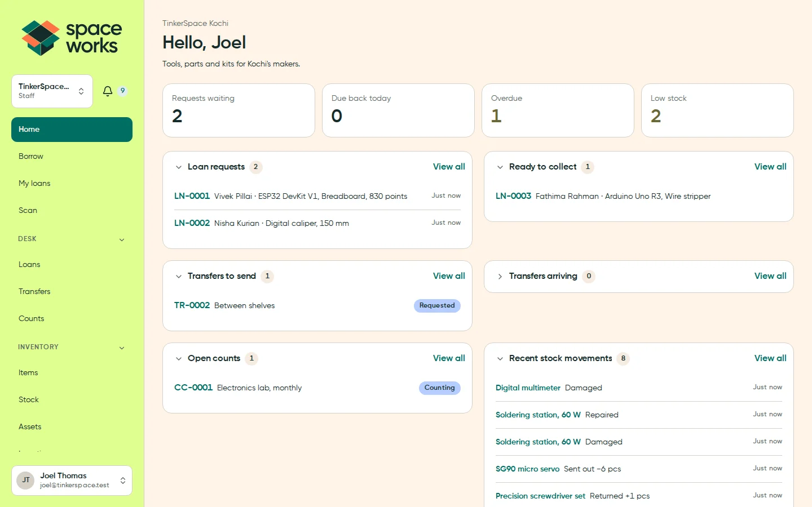<br>**Space home**: the desk queue, transfers in and out, low stock | 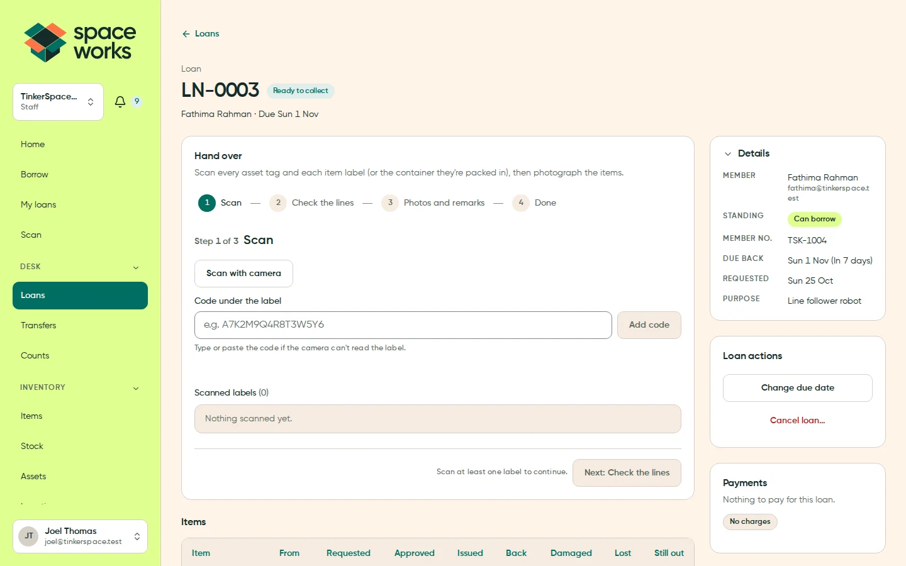<br>**Hand over a loan**: scan, check the lines, photos and remarks |
| 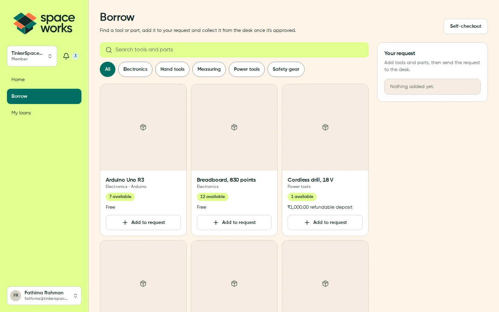<br>**Borrow**: members browse and send a request | 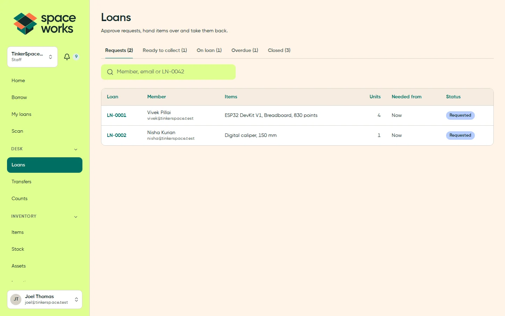<br>**Loans**: requests, ready to collect, on loan and overdue |
| 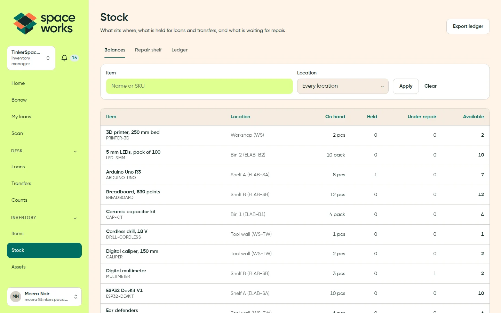<br>**Stock**: on hand, held and on loan per shelf | 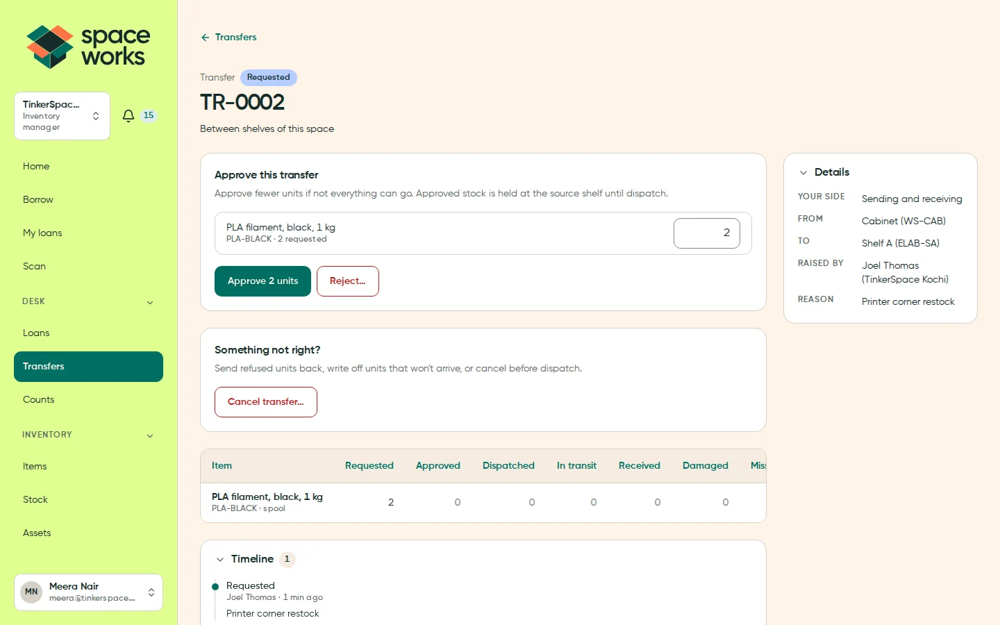<br>**Transfers** between shelves and between spaces |
| 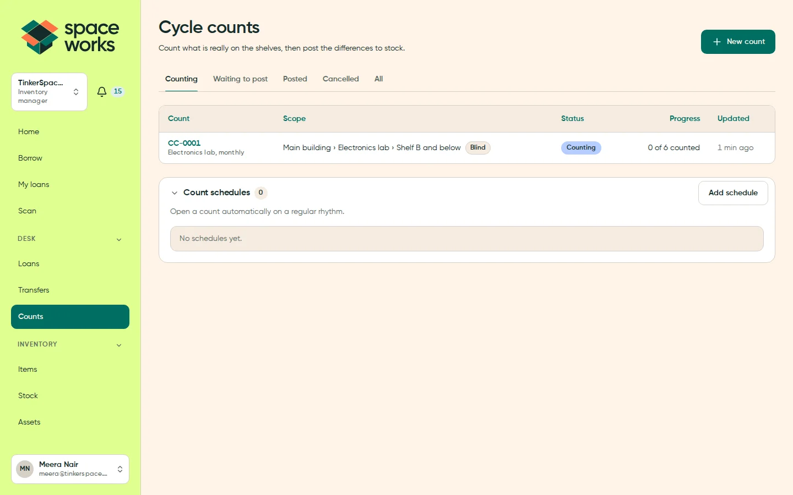<br>**Cycle counts** with blind counting and variances | 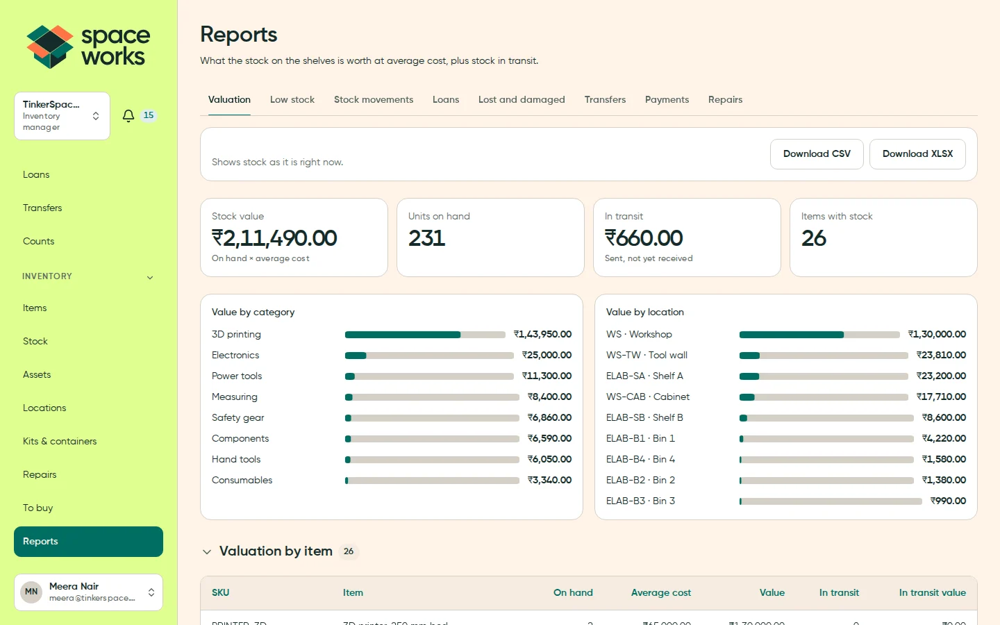<br>**Reports** with CSV and Excel exports |
| 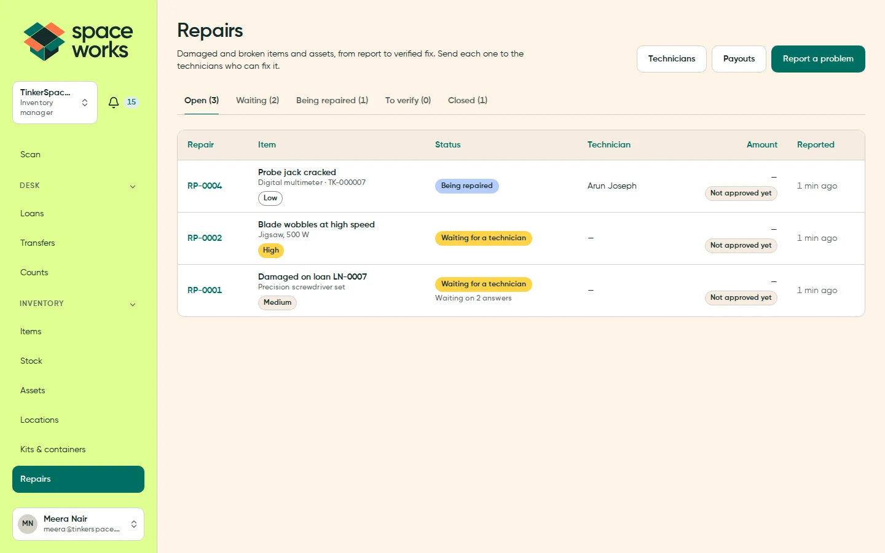<br>**Repairs**: report, send to technicians, verify and pay | 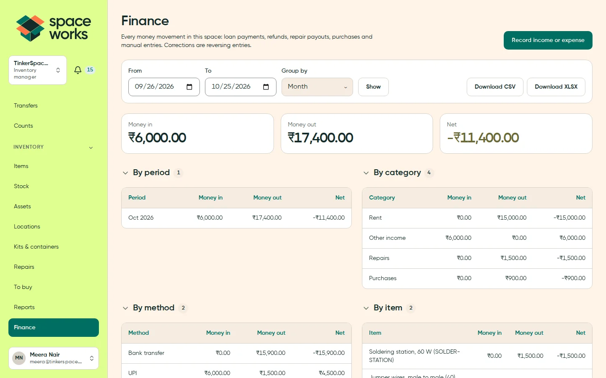<br>**Finance**: every payment, refund, payout and purchase in one ledger |
| 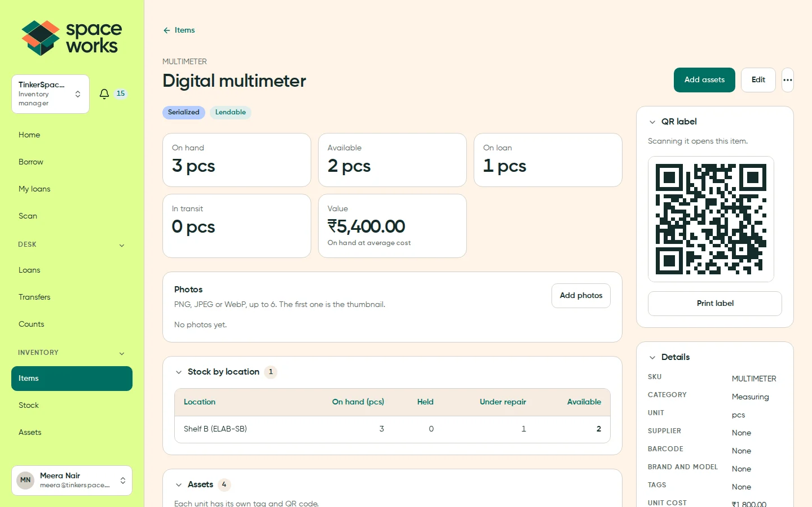<br>**Item**: stock per shelf, assets and its QR label | 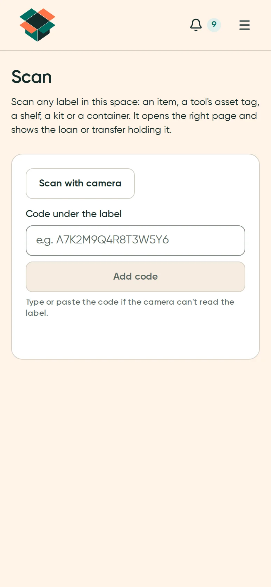<br>**Scan** any label from a phone |

More: [items](docs/screenshots/items.webp), [locations](docs/screenshots/locations.webp),
[my loans](docs/screenshots/my-loans.webp), [members](docs/screenshots/members.webp),
[a repair](docs/screenshots/repair.webp), [lending fees](docs/screenshots/settings-fees.webp), [payments](docs/screenshots/settings-payments.webp)
and the [public catalogue](docs/screenshots/public-catalogue.webp).

## Host it on a VPS with Docker

**The complete application runs on your own Linux server, installed with one line.** It ships as a
**backend** image (the app and API, which also runs migrations, the worker and beat) and a
**frontend** image (the website). The production Compose stack runs them with **PostgreSQL 16**,
**Redis 7**, private **[Silo](https://github.com/pgsty/silo)** object storage for photos and evidence,
and Caddy for automatic HTTPS. Only a domain and an SMTP relay are external.

### Install in one line

On a 64-bit Linux server (Ubuntu/Debian, Fedora/RHEL/Alma/Rocky, Arch or openSUSE), as root or a user
with `sudo`:

```bash
curl -fsSL https://raw.githubusercontent.com/SpaceWorks-HQ/SpaceWorks-Inventory/main/install.sh | bash
```

While the repository is private, give the installer a GitHub token that can read the repository and
its packages (it downloads the release and logs in to GitHub Packages with it):

```bash
export SWI_GITHUB_TOKEN=<token> SWI_GITHUB_USER=<your-github-username>
curl -fsSL -H "Authorization: Bearer $SWI_GITHUB_TOKEN" https://raw.githubusercontent.com/SpaceWorks-HQ/SpaceWorks-Inventory/main/install.sh | bash
```

It checks the server and asks every question first: the layout (website and API containers on two
hostnames, one container on one hostname, or the website on Netlify), hostnames, the admin email,
HTTPS, storage (bundled Silo or an external S3/R2 bucket), SMTP, backups and automatic deploys. One
summary lists every choice and **nothing changes until you confirm it**. Then it installs Docker if
needed, generates every secret without printing it, downloads the release's ready-made images from
[GitHub Packages](docs/CONTAINER_IMAGES.md), migrates and checks each service. Nothing is compiled on
your server.

**Before you start:** 2 vCPU, 2 GB RAM and 30 GB disk, DNS records for your hostnames, inbound ports
80 and 443, an SMTP relay on a verified sending domain, and your admin email. Phone cameras need HTTPS
to scan QR codes.

### Update, back up and check

Run the same command again. An existing installation shows a menu:

1. **Update to the latest release**: backs up the database first, keeps your settings and data.
2. **Back up now**: database, configuration and uploads.
3. **Check status and health.**
4. **Backups**: nightly schedule, encryption and off-site copies.
5. **Change settings**: hostnames, outgoing email or bucket credentials.
6. **Server security**: firewall, automatic security updates and fail2ban.
7. **Automatic deploys**: install or remove the GitHub Actions runner.
8. **Recover super-admin access**: a lost authenticator or password.
9. **Support bundle**: checks and logs for troubleshooting.
10. **Uninstall.**

`0` (the default) cancels without changing anything. Options: `--release TAG` for a specific release,
`--ref REF` to build a branch, tag or commit from source (for example `--ref dev` before the first
release; it needs 4 GB of memory), `--repo` for a fork, `--dir` for another location and `--update` to
skip the menu; `bash install.sh --help` lists them. Backups land in
`/etc/spaceworks-inventory/backups/`; restoring is a deliberate step with `scripts/vps-restore.sh`. The
**[complete VPS guide](docs/DEPLOYMENT_VPS.md)** covers manual installs, updates, rollback, restores and
monitoring.

### Can the website live on Netlify and the backend on the VPS?

**Yes.** Choose layout 3 in the installer. The VPS runs authentication, the REST API, business actions,
PostgreSQL, Redis, private storage and the jobs; the separate `frontend/` workspace renders the same
pages on Netlify and calls the backend through a signed server gateway, with CSV exports and label
printing proxied to it. The installer writes a `frontend.env` with only the website's settings. Follow
the [Netlify + VPS guide](docs/DEPLOYMENT_SPLIT.md), and register payment webhooks on the API hostname.
For a Docker app with managed dependencies, use the [Docker guide](docs/DEPLOYMENT_DOCKER.md).

## Run it for free

The optional cloud setup runs on free plans: one Docker web service on Render, managed free tiers for
the rest, and a Cloudflare Worker that delivers email and reminders every minute.

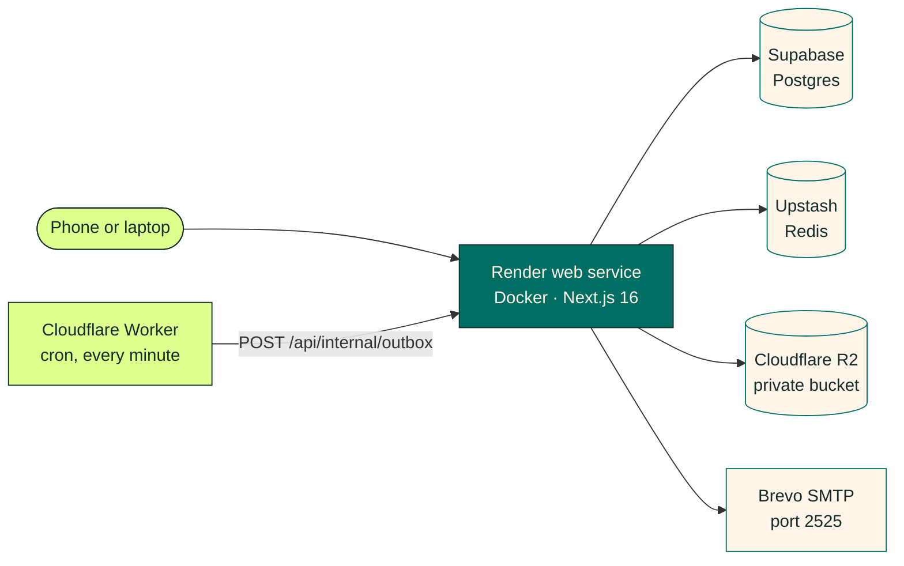

<p>
  <a href="https://render.com/deploy?repo=https://github.com/SpaceWorks-HQ/SpaceWorks-Inventory">
    
  </a>
</p>

1. **Database and cache.** Create a PostgreSQL database (for example Supabase) and an Upstash Redis
   database in the same region.
2. **Photos and email.** Create a private Cloudflare R2 bucket and a Brevo SMTP key (port 2525).
3. **Deploy.** Click **Deploy to Render** (or **New → Blueprint**) and fill in the prompts from
   [`render.yaml`](render.yaml). Migrations run when the service starts.
4. **Wake and send.** On the free plan, deploy the [cron Worker](deploy/cloudflare-cron/README.md); on
   paid plans the Blueprint's worker and beat do this.
5. **Sign in** and finish the setup wizard at `/setup`.

The [cloud guide](docs/DEPLOYMENT_CLOUD.md) has every value. A private repository must be connected to
Render through GitHub first. DigitalOcean App Platform works with [`.do/app.yaml`](.do/app.yaml).

## Quick start (local)

You need Node.js 22 and Docker (the development Compose file provides PostgreSQL, Redis, Silo and
Mailpit).

```bash
npm ci
cp .env.example .env
docker compose up -d
npm run db:deploy
DEMO_PASSWORD='choose-12-or-more-characters' npm run db:seed:demo
npm run dev
```

Open http://localhost:3000 and sign in as `anjali@tinkerspace.test` or `meera@tinkerspace.test`
(inventory managers), `joel@tinkerspace.test` (staff) or `fathima@tinkerspace.test` (member) with your
demo password. To try the first-run wizard instead, skip the seed and open `/setup`. Without SMTP,
development emails (magic links, invitations) are written to `.data/mail/`.

## Design system

Space Works Inventory follows the [Space Works design system](https://spaceworks-hq.github.io/SpaceWorks-Design/):
neutral first, accent second, and one bold moment per layout.

| | Colour | Hex | Used for |
| --- | --- | --- | --- |
|  | Deep Ink | `#142C2A` | Text, inverse surfaces, the dark mode ground |
|  | Warm Cream | `#FFF4E8` | The light mode ground, labels on teal |
|  | Maker Teal | `#006E63` | Primary actions, links and focus |
|  | Workshop Orange | `#FF7447` | One bold moment, with an ink label; never text |
|  | Citron | `#DFFF8F` | Success, the sidebar, selection |
|  | Sky Blue | `#B5CDFF` | Information |
|  | Warm Yellow | `#FFD447` | Warnings |

- **Type.** Gilroy for everything you read; Unbounded for one short accent phrase.
- **Patch,** the Space Works mascot, is the one bold moment on empty states and loaders, and hides a few
  easter eggs (try a page that doesn't exist).
- **Light and dark** everywhere; the switch reveals the new mode as a circle from the toggle.
- **Voice.** Clear, warm and specific, in sentence case and British English. Status pills always carry a
  word.

How this app applies the brand is in [docs/DESIGN.md](docs/DESIGN.md). Rebuild the README artwork with
`npm run readme:art` and the screenshots with `npm run readme:screens`.

## Documentation

| Read this | When you want to |
| --- | --- |
| [Documentation index](docs/README.md) | Find every guide |
| [Architecture](docs/ARCHITECTURE.md) | Understand tenancy, stock buckets, flows and background work |
| [Invariants](docs/INVARIANTS.md) | Know the rules every change must keep |
| [Roles](docs/RBAC.md) | See who can do what |
| [Configuration](docs/CONFIGURATION.md) | Look up settings and secrets |
| [VPS deployment](docs/DEPLOYMENT_VPS.md) | Install, update, back up and recover |
| [Netlify + VPS](docs/DEPLOYMENT_SPLIT.md) | Host the website and the backend apart |
| [Cloud deployment](docs/DEPLOYMENT_CLOUD.md) | Use Render, managed services and free plans |
| [Docker](docs/DEPLOYMENT_DOCKER.md) and [container images](docs/CONTAINER_IMAGES.md) | Run the two images anywhere |
| [API](docs/API.md) | Integrate with API keys and webhooks |
| [Testing](docs/TESTING.md) | Run the checks |
| [Operations](docs/production-operations.md) | Run it in production |
| [Decisions](docs/DECISIONS.md) | See every product decision and the owner's checks |

## Common commands

```bash
npm run dev                  # development server
npm run lint                 # ESLint (with the 300-line limit)
npm run typecheck            # TypeScript
npm run test:unit            # unit tests
npm run test:integration     # PostgreSQL-backed tests (TEST_DATABASE_URL)
npm run test:e2e             # browser tests against the development server
npm run test:e2e:vps         # production build in one container (add -- --external-services --demo)
npm run test:e2e:split       # production builds of the website and backend apart
npm run build                # production build
npm run frontend:catalog     # regenerate the split-frontend view and action catalogue
npm run readme:art           # README banner and colour swatches
```

## Contributing

Bug reports, ideas and pull requests are all welcome.

- [Report a bug](https://github.com/SpaceWorks-HQ/SpaceWorks-Inventory/issues/new) or open a pull request.
- Branch from `dev` and open your pull request against `dev`, the integration branch. `main` is
  production; only [@Shaan-Shoukath](https://github.com/Shaan-Shoukath) merges to it.
- Found a security issue? Follow [SECURITY.md](SECURITY.md) and report it privately.

Read [CONTRIBUTING.md](CONTRIBUTING.md) and [AGENTS.md](AGENTS.md) first. Keep stock changes in the
availability module, state changes in the workflow modules, and tenant and role checks on the server.

## Credits

Made by **Space Works**, a maker community that started inside TinkerSpace Kochi.

- **Domain.** Ported (not copied) from the original [SpaceWorks](https://github.com/SpaceWorks-HQ/SpaceWorks)
  makerspace manager's inventory, lending and transfer apps.
- **Platform.** The deployment and infrastructure code, background jobs and split-frontend gateway are
  adapted from [Space Works Workspace](https://github.com/SpaceWorks-HQ/SpaceWorks-Workspace) (see
  [NOTICE](NOTICE)); the colour-mode reveal and Patch's walk on the 404 page come from
  [Space Works Events](https://github.com/SpaceWorks-HQ/SpaceWorks-Events).
- **Brand.** The Space Works identity, Patch and the README art come from the
  [Space Works design system](https://github.com/SpaceWorks-HQ/SpaceWorks-Design).
- **Fonts.** Gilroy by Radomir Tinkov, and [Unbounded](https://github.com/googlefonts/unbounded) by the
  Unbounded Project Authors under the SIL Open Font License 1.1.

## Licence

Copyright © 2026 Space Works.

Space Works Inventory is free software under the
[GNU Affero General Public License v3.0 or later](LICENSE) (`AGPL-3.0-or-later`). In plain language:

- You can use, study, change and share it, including for your own makerspace.
- If you share it, or a modified version, you share the source under the same licence.
- **If you run a modified version for other people over a network,** you must offer those users its
  source code too.
- It comes with no warranty.

See [NOTICE](NOTICE) for attribution. The fonts in `public/brand/fonts` keep their own licences (see
[`public/brand/fonts/LICENSES`](public/brand/fonts/LICENSES)) and are not covered by the AGPL.
